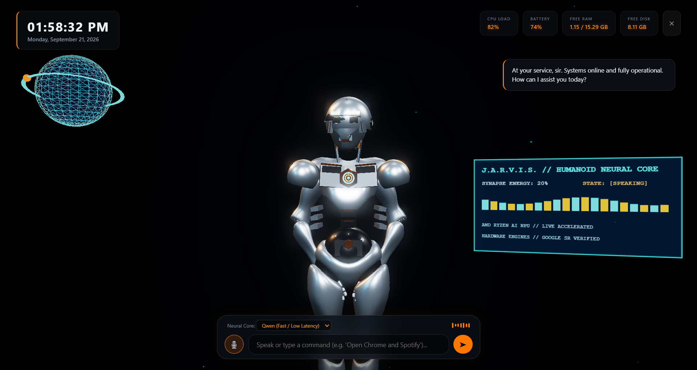

# J.A.R.V.I.S. // 3D Humanoid AI Desktop Companion

An interactive, on-device 3D AI companion rendered with Three.js and Electron. Built with real-time hardware telemetry diagnostics, dynamic voice synthesis, microphone voice input, gaze tracking, and local LLM integration via Ollama.



## Features

- **3D Humanoid Robot Architecture**:
  - PBR metallic materials (satin titanium, carbon weave undersuit, solar gold chamfers).
  - Curved obsidian visor, almond cybernetic ocular sensors with cursor gaze-tracking, and audio-reactive acoustic speech resonator.
  - Flush quantum sternum nexus with counter-rotating rings and pulsating core.
  - Smooth sinusoidal breathing and gesture kinematics.
- **Top-Left Tactical Earth Globe**: Wireframe 3D holographic globe with glowing orbital satellite ring.
- **3D In-Engine Holographic Telemetry HUD**: Real-time audio spectrum analyzer and status indicators.
- **Real-Time Hardware Telemetry**: Live CPU load, battery status, available RAM, and free disk space gathered via Windows WMI/PowerShell.
- **Voice Synthesis & Speech Recognition**:
  - Automatic speech synthesis utilizing native high-quality voices (`Microsoft David` / `Zira`).
  - Native microphone voice listening and speech recognition.
- **Local AI Brain (Ollama)**:
  - Streaming LLM inference supporting local models (`qwen:latest`, `llama3`, etc.).
  - Windows multi-application launching through natural language commands (e.g., *"Open Chrome and Spotify"*).

## Getting Started

### Prerequisites

- [Node.js](https://nodejs.org/) (v18+ recommended)
- [Ollama](https://ollama.ai/) (for local neural chat intelligence)
- Windows 10/11 (for WMI hardware telemetry and native speech engines)

### Installation

1. Clone the repository:
   ```bash
   git clone <REPO_URL>
   cd "ACE AI"
   ```

2. Install dependencies:
   ```bash
   npm install
   ```

3. Launch the desktop companion:
   ```bash
   npm start
   ```

## Controls & Interaction

- **Mouse Gaze**: Move cursor across the screen — the humanoid's eyes and head tilt smoothly follow your cursor.
- **Voice / Text Chat**: Use the bottom dock to type commands or click the microphone icon to speak.
- **Application Launcher**: Ask J.A.R.V.I.S. to launch Windows programs (e.g. Chrome, Spotify, VS Code, Notepad).
- **Exit**: Click the `✕` button on the top-right HUD to minimize or exit.

## Architecture

- `main.js`: Electron main process managing frameless fullscreen window, IPC, WMI telemetry execution, and app launcher.
- `renderer/avatar.js`: Three.js 3D scene, PBR materials, procedural humanoid armor, kinematics, gaze tracking, and holographic HUD.
- `renderer/ai-agent.js`: Telemetry polling, speech synthesis queue, audio waveform animator, and Ollama streaming connector.
- `renderer/index.html`: WebGL canvas, HUD overlays, dialogue containers, and interactive dock.
